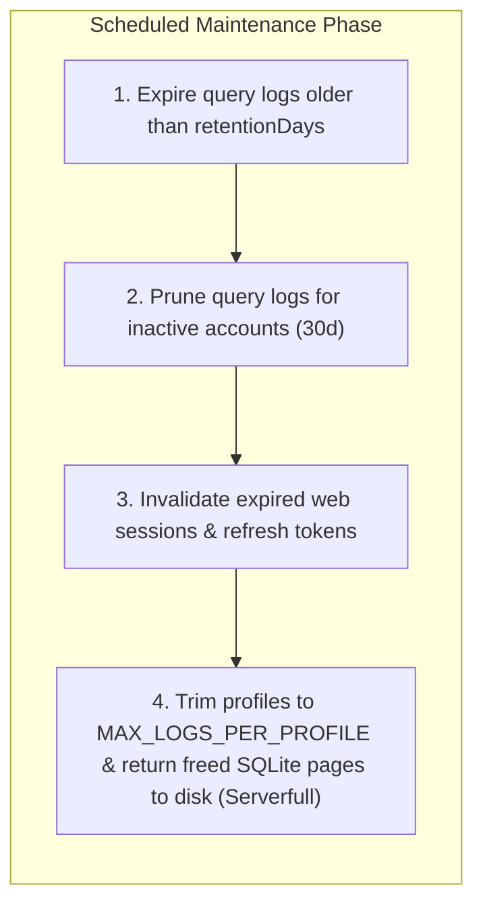

To balance auditability with user privacy and storage performance, DNS Worker incorporates an automated lifecycle and retention engine. This document covers query log retention rules, background compaction tasks, and maintenance environment variables.

---

## 1. Query Log Retention & Privacy Policies

### Maximum Retention Cap (`MAX_LOG_RETENTION_DAYS`)
Query log retention is capped by the administrator's `MAX_LOG_RETENTION_DAYS` setting (defaults to **30 days** in Serverless D1, and **360 days** in Serverfull mode).
- **Privacy Principle**: DNS resolution logs contain personal browsing trails. Configurable log retention allows operators to balance audit compliance requirements with privacy preservation.
- **Storage Efficiency**: Limiting log tables ensures database indices fit comfortably in RAM, preventing query degradation and storage exhaustion.

### 30-Day Inactivity Auto-Purge
To protect privacy and conserve disk space:
- If a profile has **no DNS resolution activity for 30 consecutive days**, its historical query logs are automatically pruned.
- **Configurations Preserved**: The user account, custom blocklists, allowlists, and profile routing keys remain intact. Only historical query log records are removed.

---

## 2. Background Task Automation

DNS Worker maintains database health through scheduled background tasks:



- **Cloudflare Workers Mode**: Executed via Cloudflare Cron Triggers (`scheduled(event, env, ctx)` handler).
- **Serverfull Node.js / Bun Mode**: Executed via background interval timers managed directly within the process.

---

## 3. High-Throughput Log Batcher Architecture

Inserting individual log rows for thousands of DNS queries per second would saturate database transaction locks. DNS Worker buffers logs in memory:

- Queries accumulate in an asynchronous memory queue.
- Logs are flushed in bulk transactions when either the batch size threshold (`LOG_BATCH_SIZE`) or timeout window (`LOG_FLUSH_INTERVAL_MS`) is met.
- In-memory buffers are protected against memory exhaustion using bounded queue limits.

---

---

## 4. Maintenance & Quotas: Serverless vs Serverfull

Because Cloudflare D1 imposes database storage and daily write quota limits (500 MB storage in the free tier, 100k daily write operations), retention caps and log budgets are calibrated differently between Serverless (`wrangler.toml`) and Serverfull (`.env.serverfull`).

| Maintenance Parameter | Serverless (`wrangler.toml`) | Serverfull (`.env.serverfull`) | Rationale & Constraint |
| :--- | :--- | :--- | :--- |
| **Admin Max Retention** (`MAX_LOG_RETENTION_DAYS`) | **30 Days** | **360 Days** | Protects D1 from storage exhaustion on Edge; permits long-term auditing on Serverfull. |
| **Admin Default Retention** (`DEFAULT_LOG_RETENTION_DAYS`) | **7 Days** | **180 Days** | High default storage allowance on local disks. |
| **Normal User Max Retention** (`NORMAL_USER_MAX_LOG_RETENTION_DAYS`) | **7 Days** | **30 Days** | Restricts non-admin user storage footprint. |
| **Normal User Default** (`NORMAL_USER_DEFAULT_LOG_RETENTION_DAYS`) | **1 Day** | **7 Days** | Minimal retention default for multi-tenant accounts. |
| **Max Log Rows per Profile** (`MAX_LOGS_PER_PROFILE`) | `500,000` (not enforced on D1: counting rows is billed as reads) | **500,000** | Circuit-breaker when query rates exceed deletion rate. Enforced in Serverfull File (SQLite) mode only. |
| **Cleanup Batch Limit** (`LOG_CLEANUP_BATCH_LIMIT`) | `1000` rows/run | `20,000` rows/run | Prevents database transaction timeouts during cron runs. |
| **Daily Deletion Budget** (`LOG_CLEANUP_DAILY_BUDGET`) | `20,000` rows/day | `0` (no daily limit) | Conservatively preserves 80% of D1's 100k daily write quota. Local disks have no write quota. |
| **Account Inactivity Threshold** (`INACTIVITY_THRESHOLD_DAYS`) | `180` Days | `180` Days | Period before dormant accounts are considered abandoned. |
| **Inactivity Log Purge** | **30 Days** | **30 Days** | Prunes historical query logs for 30d inactive accounts. |

---

## 5. Maintenance Environment Variables Reference

### Retention & Quota Variables

#### `MAX_LOG_RETENTION_DAYS` & `DEFAULT_LOG_RETENTION_DAYS`
- **Supported in**: Serverless & Serverfull
- **Defaults**:
  - `wrangler.toml`: Max `30`, Default `7`
  - `.env.serverfull`: Max `360`, Default `180`
- **Description**: Upper bound and default lifetime for query logs of administrator profiles.

#### `NORMAL_USER_MAX_LOG_RETENTION_DAYS` & `NORMAL_USER_DEFAULT_LOG_RETENTION_DAYS`
- **Supported in**: Serverless & Serverfull
- **Defaults**:
  - `wrangler.toml`: Max `7`, Default `1`
  - `.env.serverfull`: Max `30`, Default `7`
- **Description**: Storage quotas applied to standard non-administrator users.

#### `MAX_LOGS_PER_PROFILE`
- **Enforced in**: Serverfull with the local SQLite (`DATABASE_SERVICE=File`) backend. On Cloudflare D1 and Turso the value is ignored, because counting rows would be billed as reads.
- **Default**: `500000`. Set `0` to disable.
- **Description**: Hard ceiling on raw log rows kept per profile. Each cleanup run deletes the oldest rows beyond the cap (this is not limited by `LOG_CLEANUP_BATCH_LIMIT` / `LOG_CLEANUP_DAILY_BUDGET` and does not use up the daily budget). The cap is soft by up to one cleanup interval of new logs.

---

### Batching & Session Lifetimes

#### `LOG_CLEANUP_BATCH_LIMIT` & `LOG_CLEANUP_DAILY_BUDGET`
- **Defaults**: Serverless `1000` (Batch Limit) and `20000` (Daily Budget); Serverfull `20000` and `0` (no daily limit). Serverfull runs cleanup every `CLEANUP_INTERVAL_SEC=600` seconds (Serverless: `3600`).
- **Description**: Regulates the deletion velocity during scheduled maintenance runs to ensure operations stay well within database transaction quotas. `LOG_CLEANUP_BATCH_LIMIT` is shared by all profiles; quota that profiles without expired logs do not use is handed to profiles that still have a backlog. A `LOG_CLEANUP_DAILY_BUDGET` of `0` removes the daily limit (each run is then limited only by the batch limit and `CLEANUP_INTERVAL_SEC`).

#### `DEFAULT_SESSION_EXPIRATION_MINUTES` & `OPTIONAL_SESSION_EXPIRATION_DAYS`
- **Defaults**: `1440` (24 Hours default session) and `7` (7 Days when "Remember Me" is checked)
- **Description**: Controls JWT and database authentication session lifetimes.

#### `ACCESS_TOKEN_EXPIRATION_MINUTES` & `RTR_GRACE_WINDOW_MS`
- **Defaults**: `1` minute (short-lived Access Token) and `15000` ms (15s Refresh Token Rotation concurrency grace window).
- **Description**: Zero-trust token rotation parameters preventing stale token reuse while avoiding unexpected multi-tab logouts.

#### `AUTO_VACUUM` *(Serverfull File mode only)*
- **Default**: `INCREMENTAL`. Set `NONE` to keep the legacy behaviour (deleted rows never shrink the file).
- **Description**: Deleting log rows does not make a SQLite file smaller by itself. With `INCREMENTAL`, new databases are created with `auto_vacuum=INCREMENTAL`, and every cleanup run (and "delete logs" in the dashboard) gives free pages back to the disk in short chunks that yield to DNS traffic. The journal mode is always `WAL`, and the `-wal` file is trimmed to 64 MB after checkpoints.

**First start after upgrading (existing database).** The database is converted once with a full `VACUUM`:
- **DNS is unavailable while it runs**, because no port is open yet: about 1 to 2 seconds per 150 MB on an SSD, minutes for multi-GB databases on a hard disk. The log says when it starts and finishes.
- **Disk:** the `VACUUM` peaks at 3x the live data in total, so the data volume needs about 2.2x the live data size free (plus 64 MB). The temporary copy is written next to the database, not to `/var/tmp`. If there is not enough space, the conversion is skipped with a warning and the database is left unchanged.
- **Interruption is safe but never converges.** If the process is killed mid-way the database stays intact and unconverted, and the next start begins again. Docker's own `HEALTHCHECK` only marks the container unhealthy (the image allows a 300 s start period), but orchestrators that restart unhealthy services (Docker Swarm, `autoheal`) can kill it in a loop, and Kubernetes ignores `HEALTHCHECK`, so configure a `startupProbe` or a long enough start period there.
- **Convert offline instead** (large databases, or an orchestrator that restarts the service): stop the service, run the following once, then start it again. The next start sees the database as already converted. Set `AUTO_VACUUM=NONE` to opt out entirely.

```bash
# With the service stopped. Needs free space on the data volume of about 2.2x the live database size.
docker run --rm -v dns-worker-data:/var/lib/dns-worker --entrypoint bun <your-image> -e 'const {DatabaseSync}=require("node:sqlite"),path=require("node:path");const f=process.argv[1],d=new DatabaseSync(f);d.exec("PRAGMA temp_store_directory='"+path.dirname(f)+"'");d.exec("PRAGMA auto_vacuum=INCREMENTAL");d.exec("VACUUM");console.log("auto_vacuum =",d.prepare("PRAGMA auto_vacuum").get().auto_vacuum)' /var/lib/dns-worker/dns_worker.sqlite
```
