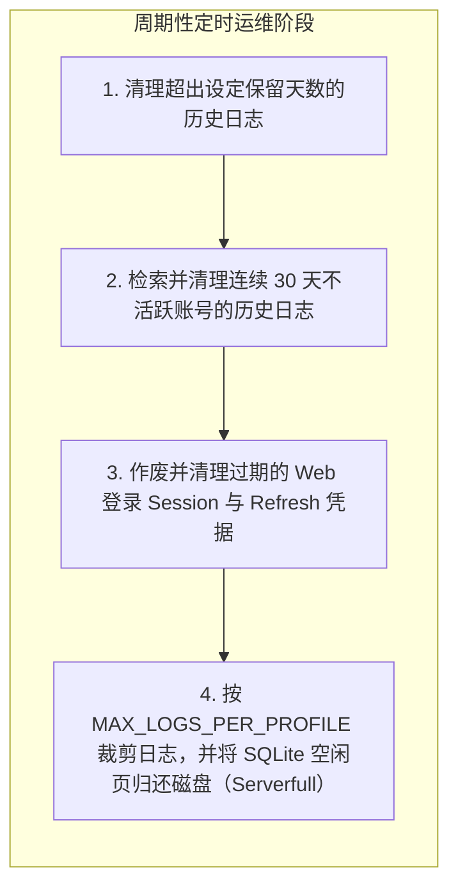

为了在可追溯审计、用户隐私保护与长期存储性能之间取得最佳平衡，DNS Worker 内置了全自动的生命周期管理引擎。本文档阐述日志保留上限策略、后台整理维护与相关环境变量。

---

## 1. 查询日志保留策略与隐私合规

### 最大保留硬性上限 (`MAX_LOG_RETENTION_DAYS`)
查询日志的保留天数受管理员设置的 `MAX_LOG_RETENTION_DAYS` 上限约束（Serverless D1 默认 **30 天**，Serverfull 模式默认 **360 天**）。
- **隐私最小化原则**：DNS 解析记录涉及高度敏感的个人行为轨迹，通过灵活可控的留存上限平衡审计合规与个人隐私。
- **数据库性能保障**：将日志控制在合理体量，可确保 SQLite 索引常驻内存，防止随着使用时间推移导致解析延迟劣变或空间耗尽。

### 30 天无解析活动自动清理 (Inactivity Purge)
为了避免长期闲置的废弃接入点持续占用宝贵的磁盘与数据库空间：
- 若某个账号在 **连续 30 天** 内未产生任何 DNS 解析流量，其历史查询日志将被自动清空。
- **配置完整保留**：账号主体信息、自定义黑白名单、接入点密钥及各类个性化设置完全保留，仅清理历史日志流水。

---

## 2. 后台自动化维护任务

DNS Worker 定期执行周期性数据库整理：



- **Cloudflare Workers 模式**：通过 Cloudflare Cron Triggers（`scheduled(event, env, ctx)` 入口）定时触发。
- **独立服务器模式 (Serverfull Node.js / Bun)**：由进程内置的高精度定时调度器常驻调度。

---

## 3. 日志批处理缓冲器 (Log Batcher)

若每产生一次 DNS 解析就同步执行一次数据库 `INSERT`，在高并发下会导致极高 I/O 阻塞。DNS Worker 采用了内存队列批量提交机制：

- 解析完成的日志先推入高并发内存队列。
- 当积压条数达到阈值（`LOG_BATCH_SIZE`）或时间到达窗口（`LOG_FLUSH_INTERVAL_MS`）时，单次事务批量写入数据库。
- 内存队列设有背压保护上限，杜绝流量突增引发的内存溢出。

---

---

## 4. 维护与配额差异对比：Serverless 与 Serverfull

由于 Cloudflare D1 数据库具有严格的存储容量（免费版 500 MB）与每日写入额度限制（100,000 次），而 Serverfull 模式基于本地物理硬盘/SSD 运行，两者的日志保留上限与删除配额经过了针对性的差异化调优：

| 维护参数 | Serverless (`wrangler.toml`) | Serverfull (`.env.serverfull`) | 差异原因与配额考量 |
| :--- | :--- | :--- | :--- |
| **管理员最长保留** (`MAX_LOG_RETENTION_DAYS`) | **30 天** | **360 天** | 保护边缘 D1 免受存储耗尽；在 Serverfull 模式下支持完整年度审计。 |
| **管理员默认保留** (`DEFAULT_LOG_RETENTION_DAYS`) | **7 天** | **180 天** | 物理磁盘拥有充裕存储，默认提供更长审计周期。 |
| **普通用户最长保留** (`NORMAL_USER_MAX_LOG_RETENTION_DAYS`) | **7 天** | **30 天** | 限制多租户场景下普通成员日志对总容量的消耗。 |
| **普通用户默认保留** (`NORMAL_USER_DEFAULT_LOG_RETENTION_DAYS`) | **1 天** | **7 天** | 最小化多用户共享环境的初始数据沉淀。 |
| **单配置最大日志行数** (`MAX_LOGS_PER_PROFILE`) | `500,000 行`（D1 上不生效：统计行数会计入读取配额） | **500,000 行** | 防止单接入点瞬时高频解析导致数据库熔断崩溃。仅在 Serverfull 本地 SQLite 模式下生效。 |
| **单次批量清理上限** (`LOG_CLEANUP_BATCH_LIMIT`) | `1000` 行/轮 | `20,000` 行/轮 | 避免 Cron 定时清理单次耗时过长触发执行超时。 |
| **每日清理最大删除配额** (`LOG_CLEANUP_DAILY_BUDGET`) | `20,000` 行/天 | `0`（不限每日） | 预留 80% 写入预算给正常业务，不耗尽 D1 免费额度；本地磁盘无写入配额。 |
| **账号闲置废弃阈值** (`INACTIVITY_THRESHOLD_DAYS`) | `180` 天 | `180` 天 | 判定长期废弃休眠账号的期限。 |
| **闲置日志自动清空** | **30 天** | **30 天** | 连续 30 天无解析流量即清空历史日志释放资源。 |

---

## 5. 维护环境变量参考手册

### 留存与存储配额变量

#### `MAX_LOG_RETENTION_DAYS` 与 `DEFAULT_LOG_RETENTION_DAYS`
- **支持模式**：Serverless 与 Serverfull
- **默认配置**：
  - `wrangler.toml`：上限 `30` 天，默认 `7` 天
  - `.env.serverfull`：上限 `360` 天，默认 `180` 天
- **说明**：超级管理员配置方案的日志最长留存天数与默认配置周期。

#### `NORMAL_USER_MAX_LOG_RETENTION_DAYS` 与 `NORMAL_USER_DEFAULT_LOG_RETENTION_DAYS`
- **支持模式**：Serverless 与 Serverfull
- **默认配置**：
  - `wrangler.toml`：上限 `7` 天，默认 `1` 天
  - `.env.serverfull`：上限 `30` 天，默认 `7` 天
- **说明**：针对受限普通用户的日志留存周期与配额。

#### `MAX_LOGS_PER_PROFILE`
- **生效范围**：仅 Serverfull 本地 SQLite（`DATABASE_SERVICE=File`）。Cloudflare D1 与 Turso 会忽略该值，因为统计行数会按读取计费。
- **默认值**：`500000`，填 `0` 为禁用。
- **说明**：单配置原始日志行数硬上限。每次清理任务会删除超出上限的最旧日志（不受 `LOG_CLEANUP_BATCH_LIMIT` / `LOG_CLEANUP_DAILY_BUDGET` 限制，也不消耗每日额度）。上限为软上限，最多超出一个清理周期内新增的日志。

---

### 定时任务与会话生命周期变量

#### `LOG_CLEANUP_BATCH_LIMIT` 与 `LOG_CLEANUP_DAILY_BUDGET`
- **默认值**：Serverless 为单批次 `1000` 行、每日上限 `20000` 行；Serverfull 为 `20000` 行、`0`（不限每日），清理间隔 `CLEANUP_INTERVAL_SEC=600` 秒（Serverless 为 `3600`）
- **说明**：精确调控定时维护任务的删除吞吐量，确保平稳运行在底层数据库事务配额安全线内。`LOG_CLEANUP_BATCH_LIMIT` 由所有配置共享；没有过期日志的配置未用完的额度，会让给仍有积压的配置。`LOG_CLEANUP_DAILY_BUDGET` 填 `0` 表示取消每日上限（此时每轮仅受批次上限与 `CLEANUP_INTERVAL_SEC` 限制）。

#### `DEFAULT_SESSION_EXPIRATION_MINUTES` 与 `OPTIONAL_SESSION_EXPIRATION_DAYS`
- **默认值**：默认登录态 `1440` 分钟（24 小时），勾选“保持登录”为 `7` 天
- **说明**：Web 仪表盘操作会话有效期。

#### `ACCESS_TOKEN_EXPIRATION_MINUTES` 与 `RTR_GRACE_WINDOW_MS`
- **默认值**：Access Token 为 `1` 分钟，RTR 并发容错窗口为 `15000` 毫秒（15 秒）
- **说明**：零信任凭据轮换参数，有效杜绝凭据重用，同时兼顾浏览器多标签页平滑过渡。

#### `AUTO_VACUUM` *(仅 Serverfull File 模式)*
- **默认值**：`INCREMENTAL`。填 `NONE` 则保持旧行为（删除日志不会让文件变小）。
- **说明**：删除日志行本身不会让 SQLite 文件变小。启用 `INCREMENTAL` 后，新数据库以 `auto_vacuum=INCREMENTAL` 创建，每次清理任务（以及仪表盘中的“删除日志”）都会分小批把空闲页归还磁盘，并在批次间让出时间给 DNS 请求。日志模式固定为 `WAL`，`-wal` 文件在检查点后会被限制在 64 MB 以内。

**升级后的首次启动（已有数据库）**：会用一次完整 `VACUUM` 转换数据库：
- **转换期间 DNS 不可用**，因为此时尚未打开任何端口：SSD 上约每 150 MB 需 1 到 2 秒，机械硬盘上数 GB 的数据库可能需要数分钟。日志会提示开始与结束。
- **磁盘空间**：`VACUUM` 峰值占用为有效数据的 3 倍，因此数据卷需要约 2.2 倍有效数据大小的空闲空间（外加 64 MB）。临时副本写在数据库所在目录，而不是 `/var/tmp`。空间不足时会跳过转换并给出警告，数据库保持不变。
- **中途中断是安全的，但永远无法完成**：进程被杀后数据库保持完整且未转换，下次启动会从头再来。Docker 自带的 `HEALTHCHECK` 只会把容器标记为 unhealthy（镜像已设置 300 秒启动宽限期），但会重启 unhealthy 服务的编排器（Docker Swarm、`autoheal`）可能反复杀掉它；Kubernetes 会忽略 `HEALTHCHECK`，请在那里配置 `startupProbe` 或足够长的启动等待时间。
- **改为离线转换**（数据库很大，或编排器会重启服务）：停止服务，执行一次下面的命令，再启动服务；下次启动会识别为已转换。设置 `AUTO_VACUUM=NONE` 可完全关闭该功能。

```bash
# With the service stopped. Needs free space on the data volume of about 2.2x the live database size.
docker run --rm -v dns-worker-data:/var/lib/dns-worker --entrypoint bun <your-image> -e 'const {DatabaseSync}=require("node:sqlite"),path=require("node:path");const f=process.argv[1],d=new DatabaseSync(f);d.exec("PRAGMA temp_store_directory='"+path.dirname(f)+"'");d.exec("PRAGMA auto_vacuum=INCREMENTAL");d.exec("VACUUM");console.log("auto_vacuum =",d.prepare("PRAGMA auto_vacuum").get().auto_vacuum)' /var/lib/dns-worker/dns_worker.sqlite
```
