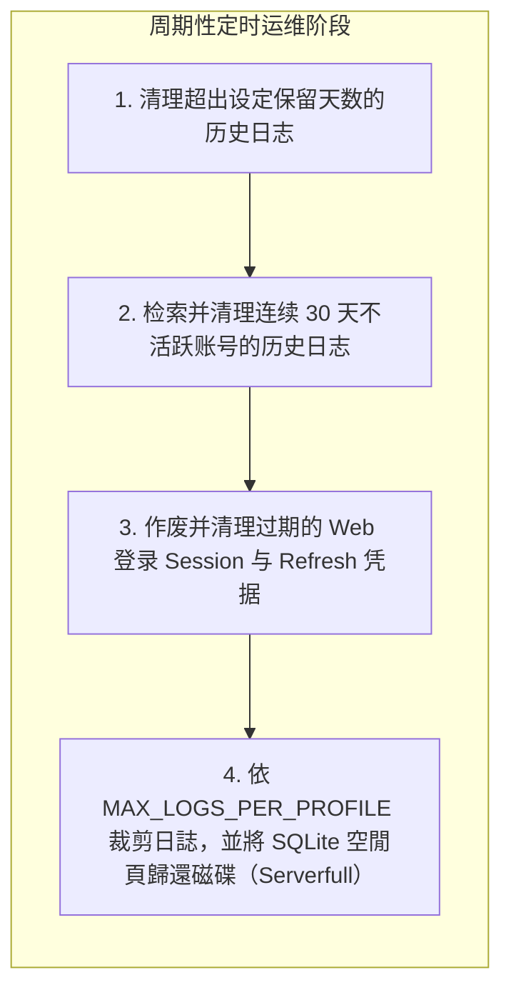

為了在可追溯審計、使用者隱私保護與長期儲存效能之間取得最佳平衡，DNS Worker 內建了全自動的生命週期管理引擎。本文件闡述日誌保留上限策略、後臺整理維護與相關環境變數。

---

## 1. 查詢日誌保留策略與隱私合規

### 最大保留硬性上限 (`MAX_LOG_RETENTION_DAYS`)
查詢日誌的保留天數受管理員設定的 `MAX_LOG_RETENTION_DAYS` 上限約束（Serverless D1 預設 **30 天**，Serverfull 模式預設 **360 天**）。
- **隱私最小化原則**：DNS 解析記錄涉及高度敏感的個人行為軌跡，通過靈活可控的留存上限平衡審計合規與個人隱私。
- **資料庫效能保障**：將日誌控制在合理體量，可確保 SQLite 索引常駐記憶體，防止隨著使用時間推移導致解析延遲劣變或空間耗盡。

### 30 天無解析活動自動清理 (Inactivity Purge)
為了避免長期閒置的廢棄接入點持續佔用寶貴的磁碟與資料庫空間：
- 若某個賬號在 **連續 30 天** 內未產生任何 DNS 解析流量，其歷史查詢日誌將被自動清空。
- **配置完整保留**：賬號主體資訊、自定義黑白名單、接入點金鑰及各類個性化設定完全保留，僅清理歷史日誌流水。

---

## 2. 後臺自動化維護任務

DNS Worker 定期執行週期性資料庫整理：



- **Cloudflare Workers 模式**：通過 Cloudflare Cron Triggers（`scheduled(event, env, ctx)` 入口）定時觸發。
- **獨立伺服器模式 (Serverfull Node.js / Bun)**：由程序內建的高精度定時排程器常駐排程。

---

## 3. 日誌批處理緩衝器 (Log Batcher)

若每產生一次 DNS 解析就同步執行一次資料庫 `INSERT`，在高併發下會導致極高 I/O 阻塞。DNS Worker 採用了記憶體佇列批次提交機制：

- 解析完成的日誌先推入高併發記憶體佇列。
- 當積壓條數達到閾值（`LOG_BATCH_SIZE`）或時間到達視窗（`LOG_FLUSH_INTERVAL_MS`）時，單次事務批次寫入資料庫。
- 記憶體佇列設有背壓保護上限，杜絕流量突增引發的記憶體溢位。

---

---

## 4. 維護與配額差異對比：Serverless 與 Serverfull

由於 Cloudflare D1 資料庫具有嚴格的儲存容量（免費版 500 MB）與每日寫入額度限制（100,000 次），而 Serverfull 模式基於本地物理硬碟/SSD 執行，兩者的日誌保留上限與刪除配額經過了針對性的差異化調優：

| 維護引數 | Serverless (`wrangler.toml`) | Serverfull (`.env.serverfull`) | 差異原因與配額考量 |
| :--- | :--- | :--- | :--- |
| **管理員最長保留** (`MAX_LOG_RETENTION_DAYS`) | **30 天** | **360 天** | 保護邊緣 D1 免受儲存耗盡；在 Serverfull 模式下支援完整年度審計。 |
| **管理員預設保留** (`DEFAULT_LOG_RETENTION_DAYS`) | **7 天** | **180 天** | 物理磁碟擁有充裕儲存，預設提供更長審計週期。 |
| **普通使用者最長保留** (`NORMAL_USER_MAX_LOG_RETENTION_DAYS`) | **7 天** | **30 天** | 限制多租戶場景下普通成員日誌對總容量的消耗。 |
| **普通使用者預設保留** (`NORMAL_USER_DEFAULT_LOG_RETENTION_DAYS`) | **1 天** | **7 天** | 最小化多使用者共享環境的初始資料沉澱。 |
| **單配置最大日誌行數** (`MAX_LOGS_PER_PROFILE`) | `500,000 行`（D1 上不生效：統計行數會計入讀取配額） | **500,000 行** | 防止單接入點瞬時高頻解析導致資料庫熔斷崩潰。僅在 Serverfull 本機 SQLite 模式下生效。 |
| **單次批次清理上限** (`LOG_CLEANUP_BATCH_LIMIT`) | `1000` 行/輪 | `20,000` 行/輪 | 避免 Cron 定時清理單次耗時過長觸發執行超時。 |
| **每日清理最大刪除配額** (`LOG_CLEANUP_DAILY_BUDGET`) | `20,000` 行/天 | `0`（不限每日） | 預留 80% 寫入預算給正常業務，不耗盡 D1 免費額度；本機磁碟無寫入配額。 |
| **賬號閒置廢棄閾值** (`INACTIVITY_THRESHOLD_DAYS`) | `180` 天 | `180` 天 | 判定長期廢棄休眠賬號的期限。 |
| **閒置日誌自動清空** | **30 天** | **30 天** | 連續 30 天無解析流量即清空歷史日誌釋放資源。 |

---

## 5. 維護環境變數參考手冊

### 留存與儲存配額變數

#### `MAX_LOG_RETENTION_DAYS` 與 `DEFAULT_LOG_RETENTION_DAYS`
- **支援模式**：Serverless 與 Serverfull
- **預設配置**：
  - `wrangler.toml`：上限 `30` 天，預設 `7` 天
  - `.env.serverfull`：上限 `360` 天，預設 `180` 天
- **說明**：超級管理員配置方案的日誌最長留存天數與預設配置週期。

#### `NORMAL_USER_MAX_LOG_RETENTION_DAYS` 與 `NORMAL_USER_DEFAULT_LOG_RETENTION_DAYS`
- **支援模式**：Serverless 與 Serverfull
- **預設配置**：
  - `wrangler.toml`：上限 `7` 天，預設 `1` 天
  - `.env.serverfull`：上限 `30` 天，預設 `7` 天
- **說明**：針對受限普通使用者的日誌留存週期與配額。

#### `MAX_LOGS_PER_PROFILE`
- **生效範圍**：僅 Serverfull 本機 SQLite（`DATABASE_SERVICE=File`）。Cloudflare D1 與 Turso 會忽略該值，因為統計行數會按讀取計費。
- **預設值**：`500000`，填 `0` 為停用。
- **說明**：單配置原始日誌行數硬上限。每次清理任務會刪除超出上限的最舊日誌（不受 `LOG_CLEANUP_BATCH_LIMIT` / `LOG_CLEANUP_DAILY_BUDGET` 限制，也不消耗每日額度）。上限為軟上限，最多超出一個清理週期內新增的日誌。

---

### 定時任務與會話生命週期變數

#### `LOG_CLEANUP_BATCH_LIMIT` 與 `LOG_CLEANUP_DAILY_BUDGET`
- **預設值**：Serverless 為單批次 `1000` 行、每日上限 `20000` 行；Serverfull 為 `20000` 行、`0`（不限每日），清理間隔 `CLEANUP_INTERVAL_SEC=600` 秒（Serverless 為 `3600`）
- **說明**：精確調控定時維護任務的刪除吞吐量，確保平穩執行在底層資料庫事務配額安全線內。`LOG_CLEANUP_BATCH_LIMIT` 由所有配置共享；沒有過期日誌的配置未用完的額度，會讓給仍有積壓的配置。`LOG_CLEANUP_DAILY_BUDGET` 填 `0` 表示取消每日上限（此時每輪僅受批次上限與 `CLEANUP_INTERVAL_SEC` 限制）。

#### `DEFAULT_SESSION_EXPIRATION_MINUTES` 與 `OPTIONAL_SESSION_EXPIRATION_DAYS`
- **預設值**：預設登入態 `1440` 分鐘（24 小時），勾選“保持登入”為 `7` 天
- **說明**：Web 儀表盤操作會話有效期。

#### `ACCESS_TOKEN_EXPIRATION_MINUTES` 與 `RTR_GRACE_WINDOW_MS`
- **預設值**：Access Token 為 `1` 分鐘，RTR 併發容錯視窗為 `15000` 毫秒（15 秒）
- **說明**：零信任憑據輪換引數，有效杜絕憑據重用，同時兼顧瀏覽器多標籤頁平滑過渡。

#### `AUTO_VACUUM` *(僅 Serverfull File 模式)*
- **預設值**：`INCREMENTAL`。填 `NONE` 則維持舊行為（刪除日誌不會讓檔案變小）。
- **說明**：刪除日誌行本身不會讓 SQLite 檔案變小。啟用 `INCREMENTAL` 後，新資料庫以 `auto_vacuum=INCREMENTAL` 建立，每次清理任務（以及儀表板中的「刪除日誌」）都會分小批把空閒頁歸還磁碟，並在批次間讓出時間給 DNS 請求。日誌模式固定為 `WAL`，`-wal` 檔案在檢查點後會被限制在 64 MB 以內。

**升級後的首次啟動（既有資料庫）**：會以一次完整 `VACUUM` 轉換資料庫：
- **轉換期間 DNS 無法使用**，因為此時尚未開啟任何連接埠：SSD 上約每 150 MB 需 1 到 2 秒，機械硬碟上數 GB 的資料庫可能需要數分鐘。日誌會提示開始與結束。
- **磁碟空間**：`VACUUM` 峰值佔用為有效資料的 3 倍，因此資料卷需要約 2.2 倍有效資料大小的空閒空間（外加 64 MB）。暫存副本寫在資料庫所在目錄，而不是 `/var/tmp`。空間不足時會跳過轉換並給出警告，資料庫保持不變。
- **中途中斷是安全的，但永遠無法完成**：程序被殺後資料庫保持完整且未轉換，下次啟動會從頭再來。Docker 自帶的 `HEALTHCHECK` 只會把容器標記為 unhealthy（映像已設定 300 秒啟動寬限期），但會重啟 unhealthy 服務的編排器（Docker Swarm、`autoheal`）可能反覆殺掉它；Kubernetes 會忽略 `HEALTHCHECK`，請在那裡設定 `startupProbe` 或足夠長的啟動等待時間。
- **改為離線轉換**（資料庫很大，或編排器會重啟服務）：停止服務，執行一次下面的指令，再啟動服務；下次啟動會識別為已轉換。設定 `AUTO_VACUUM=NONE` 可完全關閉此功能。

```bash
# With the service stopped. Needs free space on the data volume of about 2.2x the live database size.
docker run --rm -v dns-worker-data:/var/lib/dns-worker --entrypoint bun <your-image> -e 'const {DatabaseSync}=require("node:sqlite"),path=require("node:path");const f=process.argv[1],d=new DatabaseSync(f);d.exec("PRAGMA temp_store_directory='"+path.dirname(f)+"'");d.exec("PRAGMA auto_vacuum=INCREMENTAL");d.exec("VACUUM");console.log("auto_vacuum =",d.prepare("PRAGMA auto_vacuum").get().auto_vacuum)' /var/lib/dns-worker/dns_worker.sqlite
```
